БЕЛОРУССКИЙ ГОСУДАРСТВЕННЫЙ УНИВЕРСИТЕТ

Факультет прикладной математики и информатики
Кафедра технологий программирования

# Отчёт по лабораторной работе № 5

Проектирование модели управления версиями ПО, конфигурациями и непрерывной поставкой

Дисциплина «Непрерывное интегрирование и сборка программного обеспечения»

Задания 1–2 • Группа 13

Выполнил: Атаев Перман
Студент 4 курса, группа 13

Минск, 2026

## 1. Цель, вариант и границы работы

Цель: изучить автоматизацию управления инфраструктурой с Terraform и настройки узлов с Ansible. Для группы 13 по критериям методических указаний выполняются задания 1 и 2; задание 3 не входит в объём работы.

Задание 1: пройти семь руководств Get Started — Docker. Задание 2: изучить inventory, ad hoc-команды и playbook, продемонстрировать подключение к узлам, установку пакетов и публикацию конфигураций.

Адаптация стенда: отчёт ЛР №3 содержит Flask и Jaeger в Docker Compose; виртуальные машины Kubernetes в нём не создавались. Поэтому в текущей работе подготовлен отдельный кластер kind lab5 из двух контейнерных узлов. Ansible подключается через community.docker.docker, а не SSH. Это отклонение от буквального требования о виртуальных машинах из ЛР №3; согласование замены с преподавателем в представленных материалах не зафиксировано.

Отчёт основан на фактических выводах команд и 27 скриншотах. Все скриншоты включены в приложение без изменения содержимого. Конфигурационные листинги восстановлены по командам, использованным в ходе работы; прямое чтение локальных файлов компьютера автора не выполнялось.

## 2. Среда выполнения

Windows / PowerShell; Docker Desktop 4.93.0, Docker Engine и CLI 29.8.1; Terraform 1.17.1 (windows_amd64), Docker-провайдер 4.2.0. Управляющая среда Ansible: Ubuntu 24.04 в WSL 2, Python 3.12.3, ansible-core 2.21.5. kind 0.33.0; узлы Kubernetes v1.37.0, Debian 13.6, containerd 2.3.4.

Узлы: lab5-control-plane (172.24.0.4) и lab5-worker (172.24.0.3). Адреса относятся к зафиксированному запуску; inventory использует имена контейнеров. Репозиторий: https://github.com/PermanAtayevv/lab5nispo

## 3. Terraform: семь этапов

## 1. Infrastructure as Code

IaC — описание инфраструктуры в файлах, которые можно хранить в Git, проверять и применять повторно. Terraform сравнивает конфигурацию, состояние и фактические ресурсы, затем формирует план. В этой работе описаны Docker-образ и контейнер.

## 2. Install Terraform

Terraform установлен в пользовательский каталог Tools\Terraform и добавлен в PATH. Проверка показала v1.17.1. При terraform init возникла региональная блокировка реестра; после изменения условий подключения инициализация успешно установила kreuzwerker/docker 4.2.0 (рис. 1).

## 3. Build infrastructure

Созданы образ nginx:latest и контейнер lab5-terraform-nginx. Порт 8085 компьютера направлен на порт 80 контейнера с привязкой к 127.0.0.1. План: 2 to add. Apply: 2 added. Страница Nginx открылась, state list содержит два ресурса (рис. 2–3).

## 4. Change infrastructure

Внешний порт изменён с 8085 на 8086. Terraform заменил контейнер: 1 added, 1 destroyed. Страница Nginx доступна на новом порту (рис. 4–5).

## 5. Destroy infrastructure

terraform destroy удалил два ресурса из управления; state list пуст, контейнер отсутствует. keep_locally=true сохраняет скачанный образ Docker (рис. 6–7).

## 6. Define input variables

Имя вынесено в переменную container_name. Значение lab5-group13-nginx передано через -var; создан контейнер с этим именем (рис. 9–10). Ввод фрагмента HCL как команды PowerShell вызвал ошибку, но не повредил конфигурацию (рис. 8).

## 7. Query data with outputs

Добавлены container_id и container_name. terraform output вывел значения, -raw container_name вернул имя. Повторный план с тем же -var показал No changes (рис. 11).

Практика выполнялась локально в Docker Desktop. Выполнение в виртуальных лабораториях сайта, упомянутых методичкой, не подтверждено. Теоретическое содержание первого руководства изложено выше; самостоятельное прохождение его интерактивных материалов не фиксировалось.

## 4. Конфигурация Terraform

terraform/main.tf

```
terraform {
  required_providers {
    docker = {
      source  = "kreuzwerker/docker"
      version = "~> 4.2.0"
    }
  }
}
provider "docker" {
  host = "npipe:////.//pipe//docker_engine"
}
resource "docker_image" "nginx" {
  name         = "nginx:latest"
  keep_locally = true
}
resource "docker_container" "nginx" {
  name  = var.container_name
  image = docker_image.nginx.image_id
  ports {
    internal = 80
    external = 8086
    ip       = "127.0.0.1"
  }
}
```

terraform/variables.tf

```
variable "container_name" {
  description = "Name of the Docker container"
  type        = string
  default     = "lab5-terraform-nginx"
}
```

terraform/outputs.tf

```
output "container_id" {
  description = "ID of the Docker container"
  value       = docker_container.nginx.id
}
output "container_name" {
  description = "Name of the Docker container"
  value       = docker_container.nginx.name
}
```

Файл .terraform.lock.hcl создан init и должен быть сохранён в Git. Каталог .terraform/ и *.tfstate* исключаются. Параметр -var действует на один запуск: для сохранения выбранного имени при plan/apply необходимо снова передать container_name=lab5-group13-nginx.

## 5. Ansible: подготовка и подключение

Установлена Ubuntu 24.04 в WSL, создан пользователь perma. Ansible установлен через pipx install --include-deps ansible. Локальная проверка ping вернула pong (рис. 12–14). В Docker Desktop включена WSL Integration. После ошибки доступа к docker.sock установлено, что пользователь уже состоит в docker, но текущая сессия ещё не обновлена. newgrp docker активировал членство; Docker стал доступен без sudo (рис. 15–17 и вывод команд).

Создан отдельный kind-кластер lab5: управляющий и рабочий узлы имеют Ready (рис. 18). На узлах подготовлен Python через raw. Группа k8s объединяет control_plane и workers. Проверка Ansible ping успешно выполнена на обоих узлах (рис. 19).

ansible/kind-config.yaml

```
kind: Cluster
apiVersion: kind.x-k8s.io/v1alpha4
nodes:
  - role: control-plane
  - role: worker
```

ansible/inventory.ini

```
[control_plane]
lab5-control-plane

[workers]
lab5-worker

[k8s:children]
control_plane
workers

[k8s:vars]
ansible_connection=community.docker.docker
ansible_user=root
ansible_python_interpreter=/usr/bin/python3
```

## 6. Ad hoc-команды

```
ansible k8s -i ansible/inventory.ini -m ansible.builtin.ping
ansible k8s -i ansible/inventory.ini -m ansible.builtin.apt \
  -a "name=zsh state=present update_cache=yes"
ansible k8s -i ansible/inventory.ini -m ansible.builtin.command \
  -a "zsh --version"
ansible k8s -i ansible/inventory.ini -m ansible.builtin.apt \
  -a "name=zsh state=present"
```

На обоих узлах установлен zsh 5.9. Повторная установка: changed=false (рис. 20). Модуль command при чтении версии сообщает CHANGED по умолчанию; это не доказывает изменение системы. Ansible ping проверяет выполнение Python-модуля по выбранному транспорту, а не ICMP.

## 7. Playbook настройки узлов

```
---
- name: Configure lab5 nodes
  hosts: k8s
  gather_facts: true
  vars:
    required_packages:
      - zsh
  tasks:
    - name: Ensure required packages are installed
      ansible.builtin.apt:
        name: "{{ required_packages }}"
        state: present
    - name: Create lab information file
      ansible.builtin.copy:
        dest: /etc/lab5-info.txt
        owner: root
        group: root
        mode: "0644"
        content: |
          Laboratory: 5
          Group: 13
          Node: {{ inventory_hostname }}
          OS: {{ ansible_facts['distribution'] }} {{ ansible_facts['distribution_version'] }}
          Managed by: Ansible
    - name: Check zsh version
      ansible.builtin.command: zsh --version
      register: zsh_version
      changed_when: false
    - name: Show zsh version
      ansible.builtin.debug:
        var: zsh_version.stdout
```

После syntax-check выполнены первый и повторный запуски. Первый: ok=5, changed=1 на каждом узле. Повторный: ok=5, changed=0; unreachable=0, failed=0. Созданные файлы содержат правильные имена узлов и Debian 13.6 (рис. 21–23).

## 8. Nginx и обработчик изменений

```
---
- name: Configure web service on workers
  hosts: workers
  gather_facts: false
  tasks:
    - name: Install nginx
      ansible.builtin.apt:
        name: nginx
        state: present
        update_cache: true
        cache_valid_time: 3600
    - name: Configure lab web endpoint
      ansible.builtin.copy:
        dest: /etc/nginx/conf.d/lab5.conf
        owner: root
        group: root
        mode: "0644"
        content: |
          server {
              listen 127.0.0.1:8088;
              server_name localhost;
              location / {
                  default_type text/plain;
                  return 200 "Lab5 group13 - {{ inventory_hostname }}\n";
              }
          }
      notify: Restart nginx
    - name: Validate nginx configuration
      ansible.builtin.command: nginx -t
      changed_when: false
    - name: Ensure nginx is running
      ansible.builtin.systemd_service:
        name: nginx
        state: started
        enabled: true
```

## 8. Nginx: продолжение листинга

```
    - name: Apply pending handlers before HTTP check
      ansible.builtin.meta: flush_handlers
    - name: Check lab web endpoint
      ansible.builtin.uri:
        url: http://127.0.0.1:8088/
        return_content: true
        status_code: 200
      register: web_response
      until: web_response.status == 200
      retries: 5
      delay: 2
    - name: Verify response content
      ansible.builtin.assert:
        that:
          - "'Lab5 group13 - ' ~ inventory_hostname in web_response.content"
    - name: Show HTTP response
      ansible.builtin.debug:
        var: web_response.content
  handlers:
    - name: Restart nginx
      ansible.builtin.systemd_service:
        name: nginx
        state: restarted
```

notify ставит обработчик в очередь только при изменении файла. flush_handlers выполняет его до HTTP-проверки. Проверка конфигурации nginx -t предшествует запуску и перезапуску службы. URI проверяется внутри worker, поэтому адрес 127.0.0.1:8088 не является опубликованным портом Windows.

Первый запуск: ok=8, changed=4, failed=0; выполнен Restart nginx. Повторный: ok=7, changed=0, failed=0; обработчик не вызван. Проверки HTTP 200 и текста Lab5 group13 - lab5-worker успешны (рис. 24–25).

## 9. Контрольные вопросы: Ansible

1. Для каких задач применяется Ansible?

Для настройки ОС и сервисов, установки пакетов, развёртывания приложений и оркестрации действий на нескольких узлах. В работе используются apt, copy, systemd_service и uri.

2. Какие способы управления серверами применяются в Ansible?

Разовые ad hoc-команды и сценарии playbook, в том числе организованные в роли. Транспорт зависит от узла: SSH, Windows remoting и плагины подключений. Здесь используется Docker CLI через community.docker.docker.

3. Что входит в состав Ansible playbook?

YAML-список plays. Play задаёт hosts, параметры выполнения, переменные и tasks; может содержать roles, handlers, pre_tasks и post_tasks. Каждая задача вызывает модуль с аргументами.

4. Что такое группы узлов?

Именованные наборы хостов в inventory. Они позволяют применять команды и переменные к нескольким узлам. Группа k8s в работе включает дочерние control_plane и workers.

5. Как одной командой выполнить ping группы?

ansible k8s -i ansible/inventory.ini -m ansible.builtin.ping. Успех подтверждается pong; это проверка Ansible, а не сетевой ICMP ping.

6. Что такое роль Ansible?

Повторно используемая структура автоматизации с tasks, handlers, defaults, vars, files, templates и meta. Роли позволяют разделять конфигурацию по назначению. Собственная роль в данной работе не создавалась.

7. Что такое inventory и как он используется?

Источник перечня хостов, групп и переменных подключения. Может быть статическим INI/YAML или формироваться динамически. Здесь inventory.ini передаётся через -i.

8. Что такое специальная команда Ansible?

В контексте задания это ad hoc-команда: разовый вызов модуля для выбранного набора узлов без отдельного playbook. Например, установка zsh модулем apt.

9. Как перезапустить службу?

ansible workers -i ansible/inventory.ini -m ansible.builtin.systemd_service -a "name=nginx state=restarted". В playbook аналогичная задача может быть handler. Выполнение требует соответствующих прав; здесь используется root внутри узла.

## 10. Контрольные вопросы: Terraform

10. Что такое HashiCorp Terraform?

Инструмент IaC для декларативного управления ресурсами через провайдеры. Он формирует план и применяет изменения, отслеживая соответствие конфигурации реальным объектам.

11. Что такое Infrastructure as Code?

Практика описания инфраструктуры в машинно-читаемых конфигурациях с хранением в системе контроля версий, проверкой и воспроизводимым применением.

12. Как установить Terraform?

Скачать официальный архив для ОС и архитектуры, распаковать terraform.exe, добавить каталог в PATH и проверить terraform version. В работе выбран Windows AMD64.

13. Что такое провайдер?

Плагин, реализующий взаимодействие Terraform с API конкретной системы и типы ресурсов. Здесь kreuzwerker/docker управляет Docker-образами и контейнерами.

14. Базовая структура конфигурации Terraform?

terraform задаёт требования, provider — подключение, resource — управляемые объекты, variable — входные параметры, output — выходные значения. Могут использоваться data, locals и module. Все .tf в каталоге образуют общий модуль.

15. Что такое файл состояния Terraform?

Файл terraform.tfstate хранит отображение адресов ресурсов конфигурации на реальные объекты и их атрибуты. При локальном backend он находится в рабочем каталоге. Может содержать чувствительные данные, поэтому исключается из Git.

16. Для чего нужна terraform destroy?

Для удаления ресурсов, которыми управляет текущее состояние. Перед применением показывается план. В этой работе keep_locally=true сохраняет локальный образ, хотя ресурс образа удаляется из состояния Terraform.

17. Что такое состояние в Terraform?

Логическая модель известных Terraform объектов и их привязок к конфигурации. Она нужна для планирования изменений и отслеживания ресурсов; хранится локально или в удалённом backend. Это не сама конфигурация и не замена проверке реальных ресурсов.

18. Как определить зависимости?

Неявно через ссылки на атрибуты другого ресурса: image = docker_image.nginx.image_id. Для зависимостей, не выраженных данными, применяется depends_on. Terraform строит граф и выбирает порядок операций.

## 11. Результаты, ограничения и публикация

Подтверждены создание, изменение и удаление Docker-инфраструктуры Terraform, применение переменной и outputs. Ansible подключился к двум узлам kind, установил zsh и выполнил два playbook. Повторные запуски показали отсутствие изменений. Nginx прошёл проверку конфигурации, HTTP-ответа и содержимого.

Ограничения: контейнерные узлы и Docker-транспорт заменяют виртуальные машины и SSH. Примеры setup.yml и web.yml демонстрируют механизмы из документации, но не являются подтверждением выполнения всех примеров каждого внешнего руководства. Ссылка «Ansible, Playbook» из методички была недоступна при проверке; её примеры не удалось сверить. Полное выполнение соответствующего пункта нельзя считать подтверждённым.

На последних скриншотах git status показывает неотслеживаемые .gitignore, ansible/, docs/ и terraform/. Ветка main, origin соответствует lab5nispo. Наличие commit, push и Pull Request не подтверждено. Для сдачи необходимо добавить файлы, оформить публикацию и создать PR по правилам учебного репозитория. README содержит ссылки на Markdown- и PDF-отчёты.

## 12. Источники

Методические указания: НИиСПО Лабработа5 2026-2027.pdf, БГУ, страницы 3–8.

Исходный отчёт ЛР №3: report.pdf: Атаев Перман, группа 13; страницы 2–5, Docker Compose.

Terraform Docker tutorials: https://developer.hashicorp.com/terraform/tutorials/docker-get-started

Ansible command line: https://docs.ansible.com/projects/ansible/latest/command_guide/index.html

Ansible playbooks: https://docs.ansible.com/projects/ansible/latest/playbook_guide/index.html

Docker connection: https://docs.ansible.com/projects/ansible/latest/collections/community/docker/docker_connection.html

Handlers: https://docs.ansible.com/projects/ansible/latest/playbook_guide/playbooks_handlers.html

kind Quick Start: https://kind.sigs.k8s.io/docs/user/quick-start/

Материалы задания: inventory: https://www.digitalocean.com/community/tutorials/how-to-set-up-ansible-inventories

Материалы задания: ad hoc: https://www.digitalocean.com/community/cheatsheets/how-to-manage-multiple-servers-with-ansible-ad-hoc-commands

Материалы задания: playbooks: https://www.digitalocean.com/community/tutorial-series/how-to-write-ansible-playbooks

Недоступное руководство задания: https://devops.science.iu5.bmstu.ru/clusters/altvirt/ansible

## Приложение. Все скриншоты

### Рисунок 1. Terraform init: провайдер 4.2.0 успешно установлен

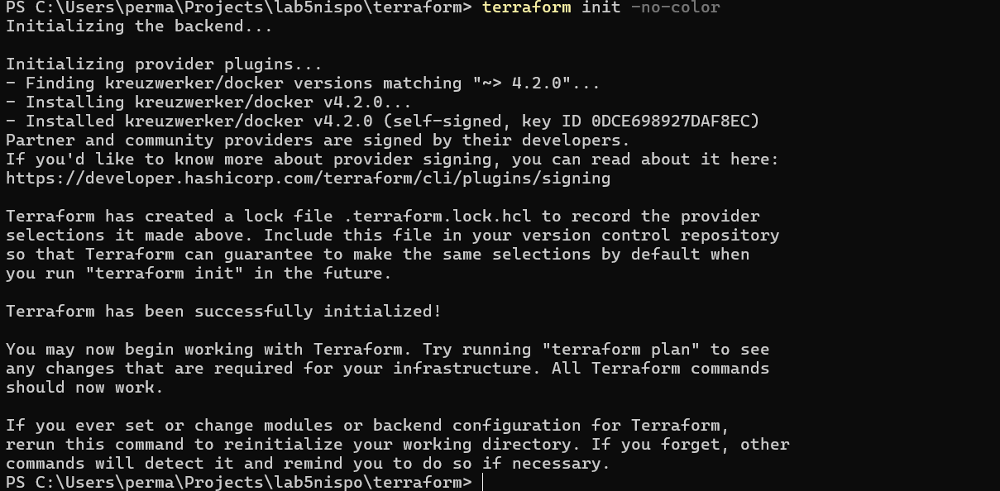

### Рисунок 2. Terraform apply: созданы два ресурса

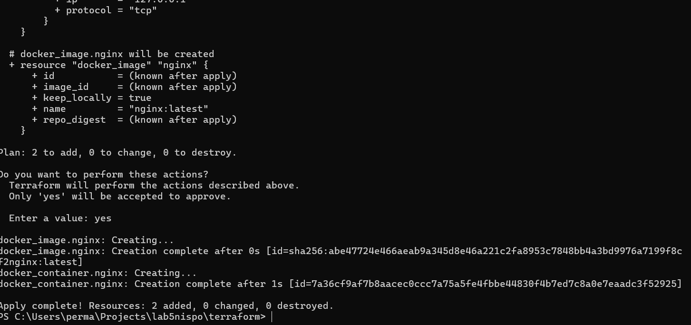

### Рисунок 3. Nginx доступен на localhost:8085

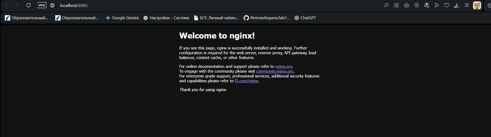

### Рисунок 4. Изменение порта: контейнер заменён

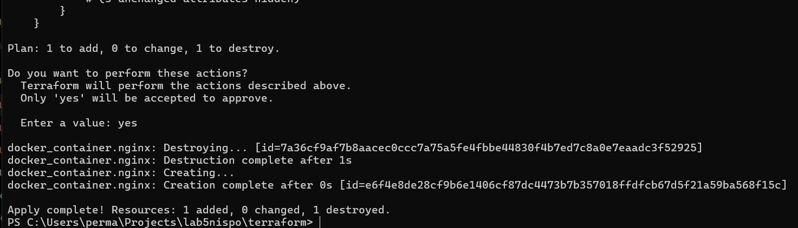

### Рисунок 5. Nginx доступен на localhost:8086

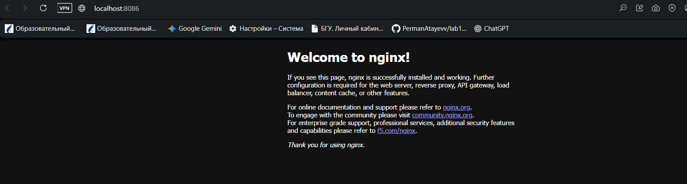

### Рисунок 6. Terraform destroy: удалены два ресурса

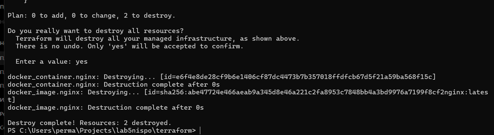

### Рисунок 7. Пустое состояние и отсутствие контейнера

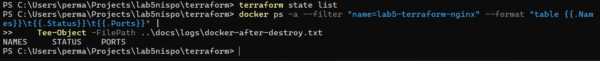

### Рисунок 8. Диагностика: HCL введён как команда PowerShell

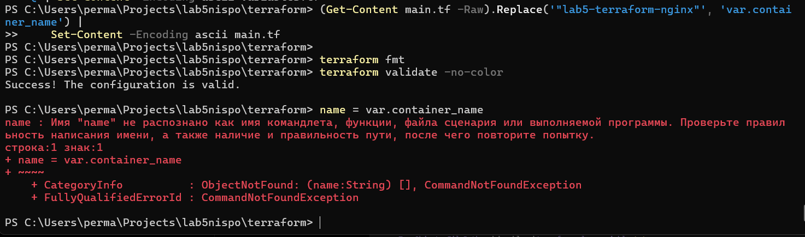

### Рисунок 9. Создание контейнера с переменной имени

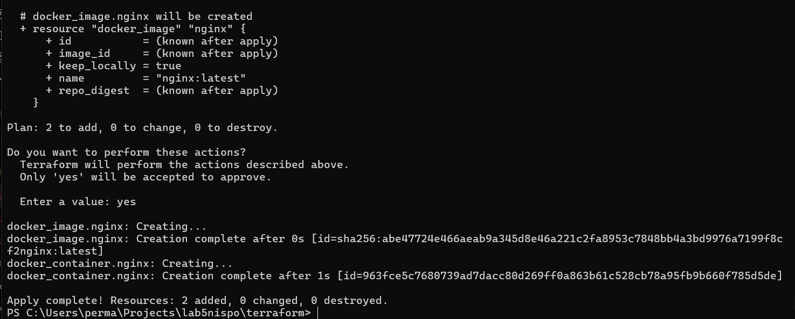

### Рисунок 10. Контейнер lab5-group13-nginx и порт 8086

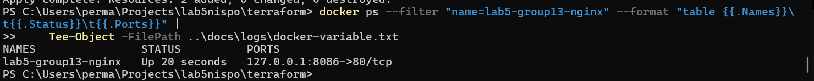

### Рисунок 11. Outputs и план без изменений

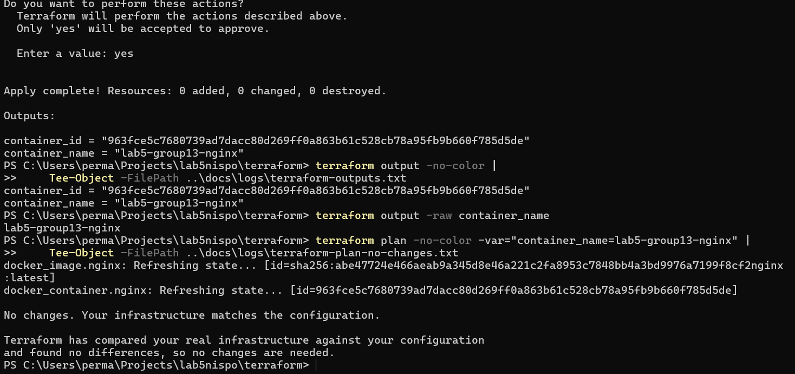

### Рисунок 12. Установка Ubuntu и создание пользователя

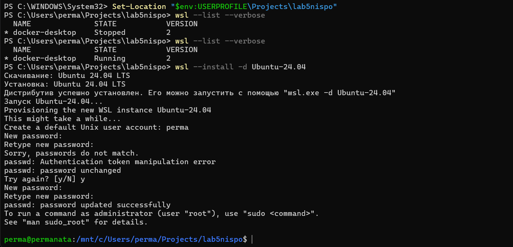

### Рисунок 13. Версии Ansible и Python

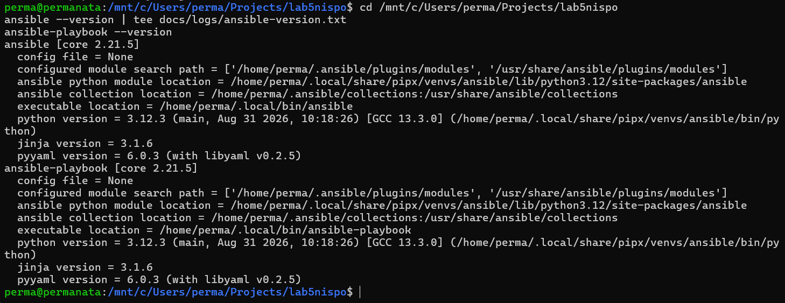

### Рисунок 14. Локальная проверка Ansible ping

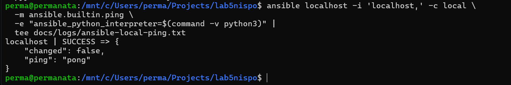

### Рисунок 15. Диагностика: отсутствует интеграция Docker с Ubuntu

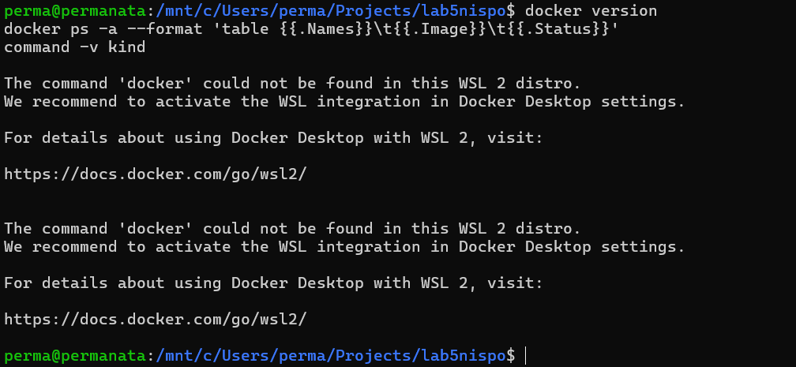

### Рисунок 16. Диагностика: отказ доступа к Docker socket

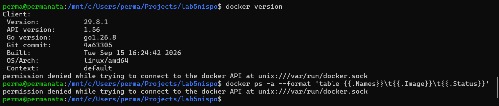

### Рисунок 17. Диагностика прав: группы и успешный sudo docker version

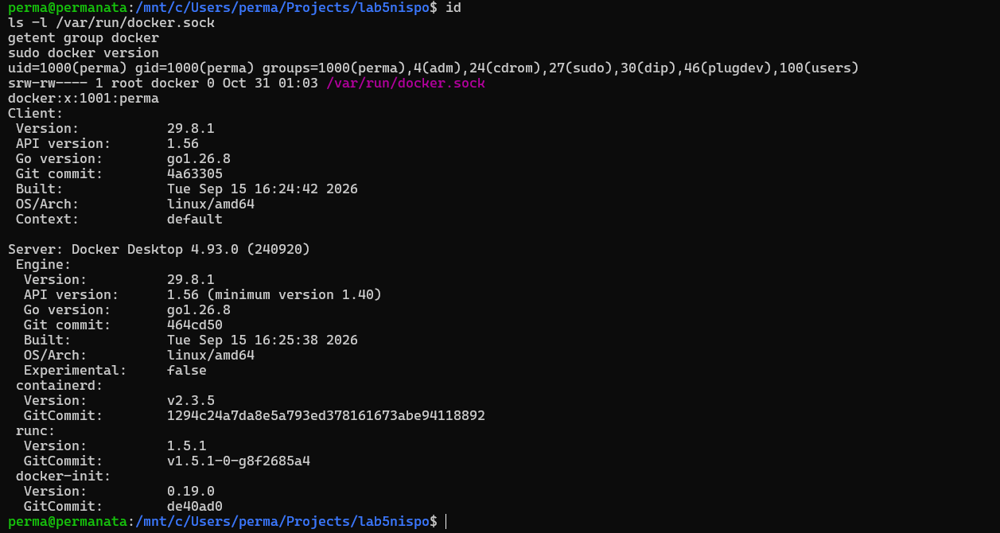

### Рисунок 18. Два узла kind имеют Ready

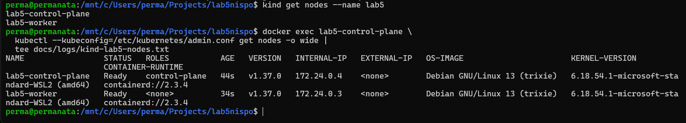

### Рисунок 19. Ansible ping: оба узла доступны

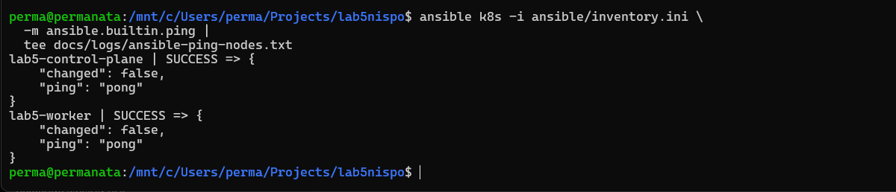

### Рисунок 20. zsh 5.9 и повторная установка без изменений

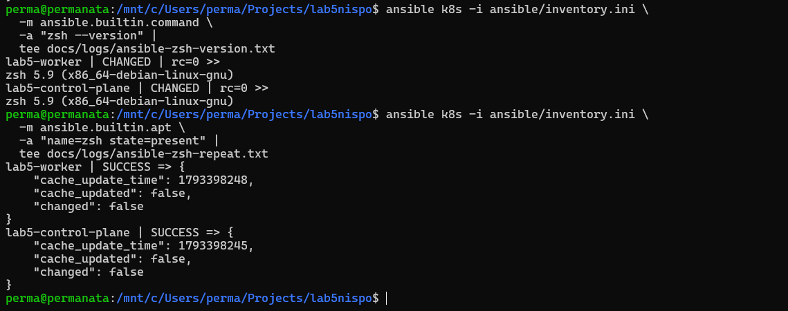

### Рисунок 21. Содержимое файлов с информацией об узлах

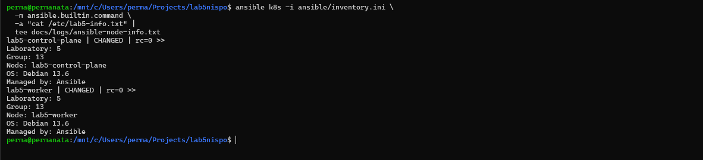

### Рисунок 22. Сравнение первого и повторного запуска setup.yml

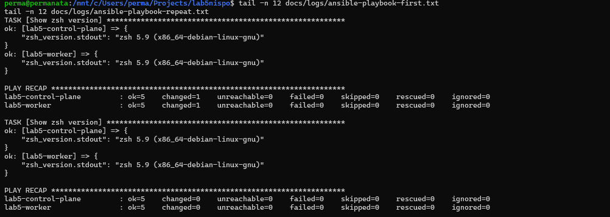

### Рисунок 23. Повторный setup.yml: changed=0

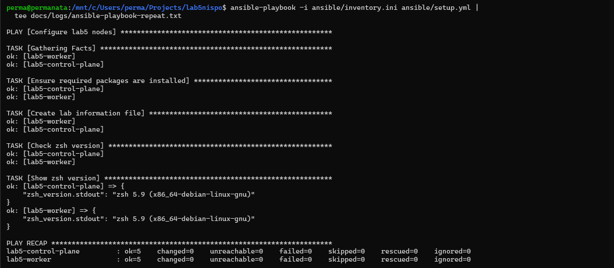

### Рисунок 24. Первый web.yml: handler и HTTP-проверки

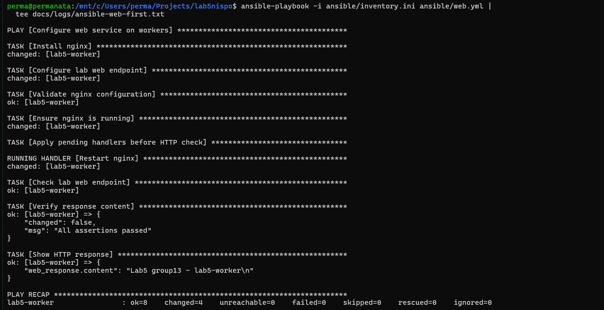

### Рисунок 25. Повторный web.yml: changed=0

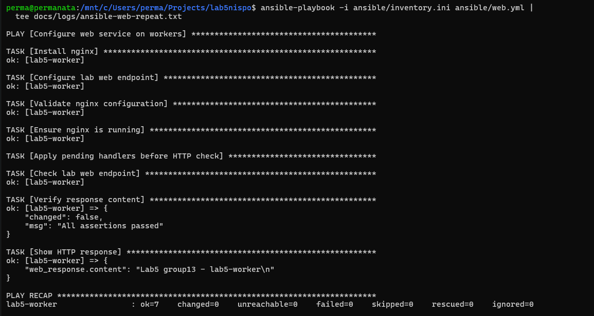

### Рисунок 26. Git: неотслеживаемые файлы, ветка и origin

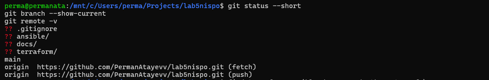

### Рисунок 27. Перечень конфигураций и журналов

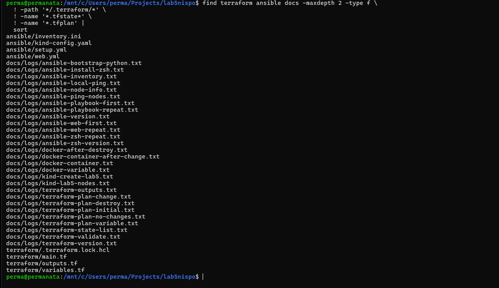
